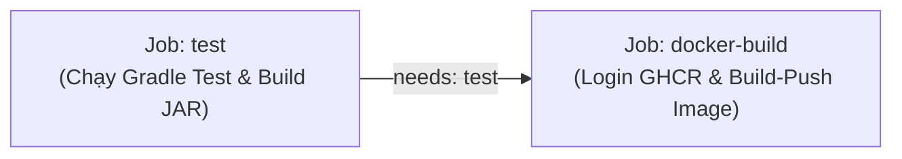

# Bài tập Session 11 - Bài 5: Nối Job tự động Build & Push Docker Image sau khi Test Gradle xanh

Dự án Spring Boot Gradle kết hợp GitHub Actions CI/CD pipeline gồm 2 Job riêng biệt liên kết bằng từ khóa `needs: test`:
1. **Job `test`**: Kiểm thử toàn bộ ứng dụng bằng JUnit Test và đóng gói file JAR thực thi (bootJar).
2. **Job `docker-build`**: Nhận file JAR từ Job test, đóng gói thành Docker Image và tự động đẩy lên GitHub Container Registry (`ghcr.io`).

---

## 1. Mục tiêu bài tập

- **Phân tách luồng CI (Separation of Concerns)**: Tách riêng biệt bước kiểm thử/đóng gói ứng dụng (`test`) và bước đóng gói hạ tầng container (`docker-build`).
- **Ràng buộc thứ tự thực thi bằng `needs`**: Đảm bảo chỉ khi Job `test` chạy thành công (màu xanh) thì Job `docker-build` mới được kích hoạt.
- **Chia sẻ Artifact giữa các Job**: Sử dụng `actions/upload-artifact@v4` và `actions/download-artifact@v4` để tái sử dụng chính xác tệp JAR đã được test, tránh việc phải compile hoặc build lại trong Job Docker.
- **Tích hợp GitHub Container Registry (GHCR)**: Đăng nhập bằng `docker/login-action@v3` với GitHub Secret `REGISTRY_TOKEN`, chuẩn hóa tên image dạng chữ thường (lowercase) và build-push bằng `docker/build-push-action@v5`.

---

## 2. Cấu trúc thư mục dự án

```text
session11-ex5/
├── .github/
│   └── workflows/
│       └── ci.yml               # Workflow GitHub Actions 2 Job (test -> docker-build)
├── gradle/
│   └── wrapper/
│       ├── gradle-wrapper.jar
│       └── gradle-wrapper.properties
├── src/
│   ├── main/
│   │   ├── java/com/example/session11ex5/
│   │   │   ├── HelloController.java          # REST API endpoint chào mừng
│   │   │   └── Session11Ex5Application.java  # Main class Spring Boot
│   │   └── resources/
│   │       └── application.properties
│   └── test/
│       └── java/com/example/session11ex5/
│           └── Session11Ex5ApplicationTests.java # JUnit 5 test kiểm tra context và logic
├── .dockerignore                 # Danh sách loại trừ khi build Docker context
├── .gitignore                    # Bỏ qua file rác, build artifacts, IDE
├── build.gradle                  # Cấu hình Gradle Groovy, Java 17 toolchain
├── Dockerfile                    # Đóng gói file JAR với Eclipse Temurin 17 JRE Alpine
├── gradlew                       # Shell script chạy Gradle trên Linux/macOS
├── gradlew.bat                   # Batch script chạy Gradle trên Windows
└── README.md                     # Tài liệu hướng dẫn chi tiết
```

---

## 3. Hướng dẫn chạy và kiểm tra tại Local

### 3.1. Chạy JUnit Test trên Windows
Chạy lệnh sau trong PowerShell hoặc CMD tại thư mục gốc của dự án:
```powershell
.\gradlew.bat test
```
- Khi chạy thành công, kết quả báo `BUILD SUCCESSFUL`.
- Báo cáo kết quả kiểm thử được tạo tại `build/reports/tests/test/index.html`.

### 3.2. Đóng gói file JAR thực thi (bootJar)
```powershell
.\gradlew.bat bootJar
```
- Tệp JAR sẽ được sinh ra tại: `build/libs/session11-ex5-0.0.1-SNAPSHOT.jar`.
- Lưu ý: Task `jar` (plain jar) đã được tắt trong `build.gradle` để đảm bảo trong thư mục `build/libs/` chỉ có duy nhất 1 file executable JAR chuẩn.

### 3.3. Build Docker Image tại máy cục bộ
```powershell
docker build -t session11-ex5:local .
```

### 3.4. Khởi chạy và kiểm tra Docker Container
```powershell
docker run --rm -p 8080:8080 --name app-container session11-ex5:local
```
Mở trình duyệt hoặc dùng lệnh curl / PowerShell:
```powershell
Invoke-RestMethod http://localhost:8080/
```
Kết quả trả về:
```text
Spring Boot CI/CD - Session 11 Exercise 5!
```

---
## 4. Cấu trúc kịch bản CI/CD (`.github/workflows/ci.yml`)

Workflow được chia thành 2 Job kết nối tuần tự:



- **Job `test`**:
  - `actions/checkout@v4`: Lấy mã nguồn.
  - `actions/setup-java@v4`: Cài đặt môi trường JDK 17 (Temurin).
  - Chạy `./gradlew test bootJar`: Kiểm thử toàn bộ mã nguồn và đóng gói JAR.
  - `actions/upload-artifact@v4`: Tải file `build/libs/*.jar` lên hệ thống lưu trữ artifact với tên `app-jar`.

- **Job `docker-build`**:
  - `needs: test`: Ràng buộc điều kiện tiên quyết, **chỉ thực thi khi Job test màu xanh**.
  - `actions/download-artifact@v4`: Tải artifact `app-jar` về đặt vào đúng thư mục `build/libs/`.
  - Chuyển đổi tên repository thành chữ thường (lowercase) để đảm bảo tuân thủ chuẩn đặt tên tag của Docker.
  - `docker/login-action@v3`: Đăng nhập vào `ghcr.io` sử dụng `${{ secrets.REGISTRY_TOKEN }}`.
  - `docker/build-push-action@v5`: Đóng gói Dockerfile và đẩy image lên GHCR với các thẻ `latest` và commit SHA.

---

## 5. Hướng dẫn nghiệm thu và kiểm tra trên GitHub Actions

### Kịch bản 1: Test màu xanh -> Tự động đóng gói & đẩy Docker Image thành công
1. Đảm bảo toàn bộ test case đang hoạt động đúng.
2. Commit và push code lên nhánh chính (`main`):
   ```bash
   git add .
   git commit -m "feat: complete exercise 5 CI pipeline with test and docker-build jobs"
   git push -u origin main
   ```
3. Truy cập tab **Actions** trên repository GitHub:
   - Bạn sẽ thấy Workflow **CI - Test & Docker Build** đang chạy.
   - Click vào Workflow run để mở giao diện sơ đồ: Quan sát **mũi tên liên kết từ Job `test` sang Job `docker-build`**.
   - Chờ Job `test` hoàn thành màu xanh (Success) -> Job `docker-build` tự động được kích hoạt -> Hoàn thành màu xanh.
4. Kiểm tra Docker Image trên GHCR:
   - Vào trang GitHub Profile hoặc trang chủ Repository -> Mục **Packages**.
   - Kiểm tra package đã xuất hiện với địa chỉ dạng:
     `ghcr.io/<tên-tài-khoản>/<tên-repo>:latest`

### Kịch bản 2: Test thất bại -> Job `docker-build` tự động bị Bỏ qua (Skipped)
1. Mở file [Session11Ex5ApplicationTests.java](file:///src/test/java/com/example/session11ex5/Session11Ex5ApplicationTests.java).
2. Sửa một assertion làm hỏng bài test, ví dụ:
   ```java
   @Test
   @DisplayName("Kiểm tra logic nghiệp vụ cơ bản")
   void testBasicLogic() {
       String status = "DOWN"; // Cố tình làm sai logic
       assertTrue(status.equals("UP"), "Trạng thái ứng dụng phải là UP");
   }
   ```
3. Commit và push code:
   ```bash
   git add src/test/java/com/example/session11ex5/Session11Ex5ApplicationTests.java
   git commit -m "test: simulate failing test to verify docker-build is skipped"
   git push origin main
   ```
4. Quan sát trên tab **Actions**:
   - Job `test` chạy thất bại (màu đỏ - Failed).
   - Job `docker-build` lập tức hiển thị trạng thái **Skipped** (màu xám / biểu tượng bị bỏ qua), **hoàn toàn không được kích hoạt**, không thực hiện login và không tạo image lỗi lên registry.
5. Sửa lại bài test cho đúng và push lại để pipeline trở lại màu xanh.

